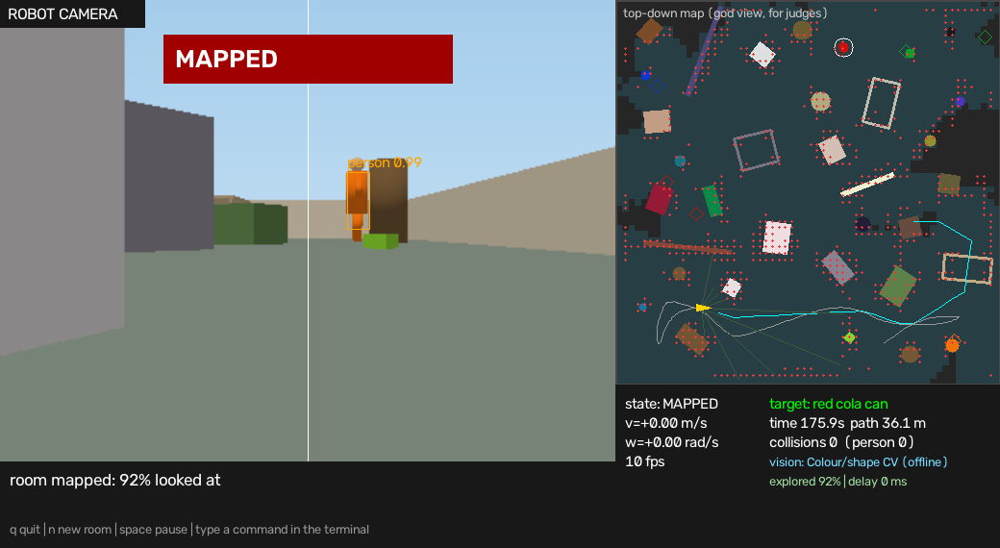

# SIGHTWAY — AI-Vision Autonomous Robot

*See it. Remember it. Reach it safely.*

Hack in Hills '26 · Track 01: Vision-Based Autonomous Robot
Team: **[TEAM NAME]** — Satyam Kumar (leader), Akshat Anand  ·  Demo video: **[LINK]**

SIGHTWAY is a vision-guided robot that **maps a room once, remembers where objects are, and then drives
straight to whichever object you name** by the shortest safe route. It replans when something unexpected
appears. The prototype runs in a PyBullet simulator; the "brain" outputs only a speed and a turn rate `(v, w)`,
so the simulated car can later be replaced by a real ESP32 RC car.

> **Status in one line:** everything below under *Built* works and was tested **in simulation**.
> The Android-phone camera, the ESP32 link and cloud VLM help are **proposed** (see [Roadmap](#roadmap)).
> No hardware results are claimed.



---

## What is built (simulation) vs proposed

| Capability | Status |
|---|---|
| Room exploration until no reachable area is left unsearched | **Built** |
| Persistent room map: obstacles, searched area, object locations (auto-saved, wiped on reset) | **Built** |
| Object recognition: YOLOv8n trained on simulator data + colour/shape fallback | **Built** |
| Label-free "unknown object" hazards from the camera | **Built** |
| Theta\* any-angle route planning with configurable safety margins | **Built** |
| Pure-pursuit path following, local avoidance, automatic replanning | **Built** |
| Instant target switching from the saved map | **Built** |
| Delay-aware motion (works when vision is slow; `--latency` to test) | **Built** |
| Android phone as camera + on-device processing | *Proposed* |
| ESP32 RC car receiving `(v, w)` over Wi-Fi/Bluetooth | *Proposed* |
| Cloud VLM naming unfamiliar objects (`--detector yoloworld` hook exists, untested) | *Proposed / optional* |
| Real-camera detector training and real-robot margin tuning | *Planned* |

---

## How it works

```
Camera + 9 sonar rays ──► Detector (AI + colour check) ──┐
                     └──► Unknown-object hazard check ───┤
                                                         ▼
                       World map (obstacles · searched area · object locations)
                                                         │
User command ──► Target selection ──► Theta* planner ──► Pure-pursuit follower ──► (v, w) ──► car
                         ▲                  ▲                      │
                         └──── replanning monitor ◄──────────────┘  (blocked / drifted / target moved)
```

1. **Capture & recognise** — camera frames go to the detector; the colour check double-checks the label.
2. **Map & localise** — detections and range readings update a 15 cm grid map; pose is tracked by dead reckoning
   (a real car would use wheel encoders).
3. **Select target** — "go to the blue can" picks the best remembered spot: spots that never failed a visit first,
   then verified spots, then the shortest route.
4. **Plan** — Theta\* finds a straight-line route using driving time as cost, with safety margins
   (robot size, sensor/position/map error, stopping distance).
5. **Follow** — pure pursuit turns the route into `(v, w)`; local avoidance runs only if something is really in the way.
6. **Monitor & replan** — blocked, off-route, or target moved → replan from the current pose.
7. **Approach** — when the target is steadily detected, plan to the cheapest reachable stopping spot with a clear view.

**Mapping mode** explores until nothing reachable is unsearched, remembering obstacles and objects in memory
(auto-saved to a temporary file). **Switching targets** clears every old goal and route, picks the new target from
memory, and plans a fresh route from where the robot stands — no re-scan.

---

## Install

Python 3.10+ recommended.

```bash
pip install -r requirements.txt   # pybullet, numpy, opencv-python, ultralytics
```

Put `robot_sim.py` and `robot_det.pt` (the trained detector) in the same folder. Without `robot_det.pt` the program
automatically uses the colour detector.

## Run

```bash
python robot_sim.py                                   # live window, default target
python robot_sim.py --target "blue energy drink can" --seed 5
python robot_sim.py --mode map --save-map room.npz    # map the whole room first
python robot_sim.py --load-map room.npz --seed 5      # then go straight to remembered objects
python robot_sim.py --headless --max-time 120         # no window
```

While it runs, type commands in the terminal: `go to the red can`, `find the person`, `map the room`, `reset map`.

| Key (window focused) | Action |
|---|---|
| `q` / `space` / `n` | quit / pause / new room |
| `s` | save the map |
| `r` | wipe the map (reset) |
| `o` | drop an unexpected obstacle 1 m ahead |
| `t` | move the target somewhere else |

### Useful options

| Option | Meaning |
|---|---|
| `--detector auto\|trained\|color\|gt\|yoloworld\|hybrid` | vision backend |
| `--mode map\|find` | map the room / find a target |
| `--save-map FILE`, `--load-map FILE` | keep / reuse a map |
| `--store FILE`, `--no-store`, `--reset-map` | temporary on-robot map storage (auto-saved every 5 s, same room only) |
| `--margin`, `--soft-margin`, `--react`, `--decel` | safety settings (extra clearance, preferred clearance, reaction time, braking) |
| `--novel` | add unfamiliar obstacles (pipe, snowman, sofa…) |
| `--no-hazard` | turn off the camera hazard layer |
| `--latency SEC` | emulate a slow detector (bench only) |
| `--bench N --target mix --csv out.csv` | run N random rooms and print a results table |
| `--video out.mp4` | record the dashboard |

## Train on your own images

```bash
python robot_sim.py --collect 1500        # auto-labelled simulator images
python robot_sim.py --train --epochs 40   # add --fast on a CPU-only laptop
```

For real-world use, add labelled photos from your real camera to `dataset/` (YOLO format, same classes as
`dataset/data.yaml`) and train again. See [Limitations](#limitations).

## Tests

```bash
python test_nav.py        # or: pytest -q test_nav.py
```

Covers: exploration stops only when nothing reachable is left (and never revisits a spot), an obstacle-free route is
followed directly, an unexpected obstacle causes a replan and the route resumes, and repeated target switching
always heads to the requested object by a short route.

---

## Results (simulation only)

Measured with the trained detector on 8 random simulated rooms (`--bench 8 --seed 900 --target mix`):

| Metric | Result |
|---|---|
| Target reached | **8 / 8** |
| Collisions | **0** |
| Average time to reach target | ~27 s |
| Room mapped (3 rooms, free floor looked at) | 85–90 %, 0 collisions |
| Consecutive target switches (7 legs, one room) | 7 / 7 reached |

Earlier build: with an artificial 0.8 s detector delay, 8 / 8 rooms were still solved. One room showed the memory
benefit: finding a can took ~20 s with a saved map vs ~100 s without. These are small simulator test sets, not
hardware results.

## Limitations

- Simulation only; the detector was trained on simulated images and needs real photos for real cameras.
- The colour detector fails to find the target in one of the benchmark rooms.
- The object memory can keep a few false locations next to the real ones.
- Safety margins and speeds are tuned for the simulator and must be re-tuned on a real car.
- Pose comes from simulated dead reckoning; a real car needs encoders (and ideally an IMU).

## Roadmap

1. **Now:** simulator prototype (this repo).
2. **Next:** collect real photos of the cans, retrain the detector.
3. **Then:** ESP32 car link — send `(v, w)` and convert to left/right wheel speeds; optional ultrasonic sensor.
4. **Later:** optional cloud VLM for unfamiliar objects; multi-room mapping.

## Project layout

```
robot_sim.py          simulator, detectors, map, planner, follower, dashboard, CLI
test_nav.py           navigation regression tests
robot_det.pt          trained YOLOv8n detector (simulator-trained)
requirements.txt      Python dependencies
LICENSE               MIT
CHANGELOG.md          what is in this release
docs/
  ARCHITECTURE.md     components, data flow, persistence
  ALGORITHMS.md       mapping, exploration, Theta*, safety, following, memory (with diagrams)
  VLM_DESIGN.md       proposed cloud-VLM design and token-saving rules (not built)
  HARDWARE_PLAN.md    proposed Android + ESP32 path (not built)
  TESTING.md          tests, benchmark commands, measured results, known issues
  DEMO_GUIDE.md       shot list for the demo video
  SUBMISSION_CHECKLIST.md
  images/             diagrams (D1-D8, architecture, results) and simulator screenshots
```

## Documentation

- [Architecture](docs/ARCHITECTURE.md) · [Algorithms](docs/ALGORITHMS.md) · [Testing and results](docs/TESTING.md)
- Proposed, not built: [VLM design](docs/VLM_DESIGN.md) · [Hardware plan](docs/HARDWARE_PLAN.md)
- [Demo guide](docs/DEMO_GUIDE.md) · [Submission checklist](docs/SUBMISSION_CHECKLIST.md)

## Team

- **Satyam Kumar** (team leader) · [role] · [contact]
- **Akshat Anand** · [role] · [contact]

## License

MIT. See [LICENSE](LICENSE).
