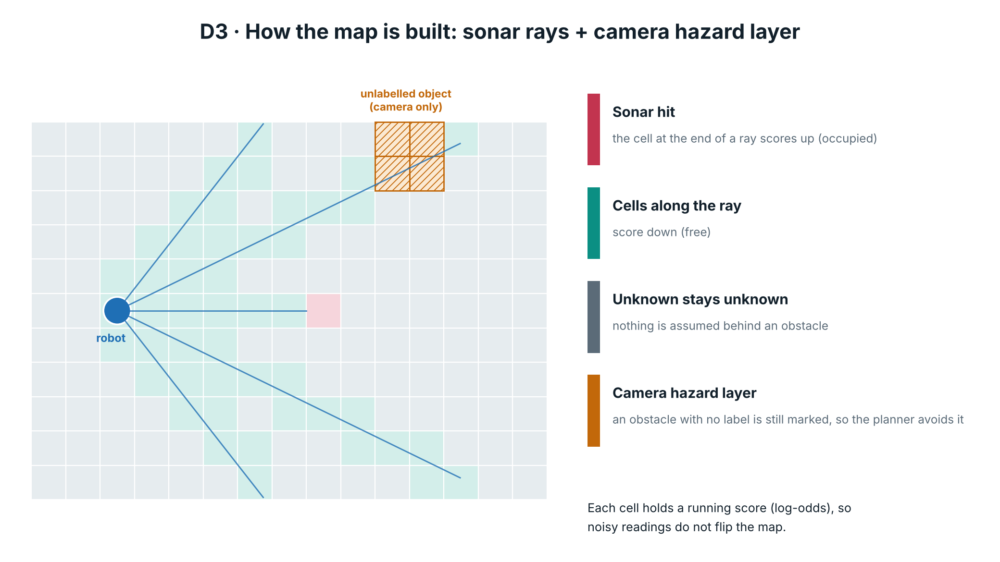
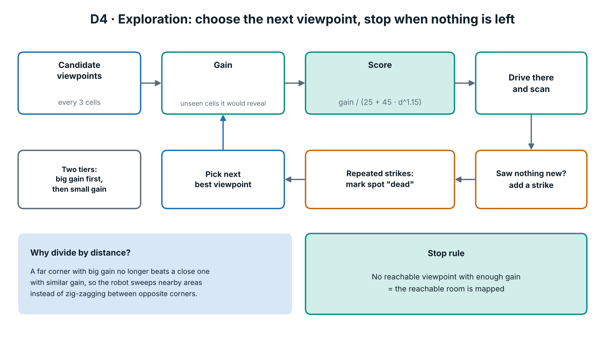
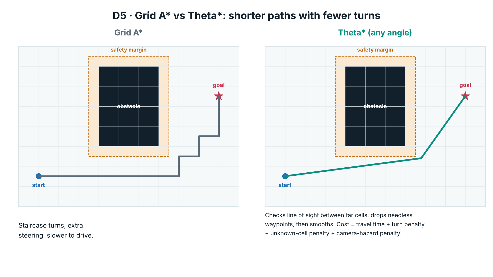
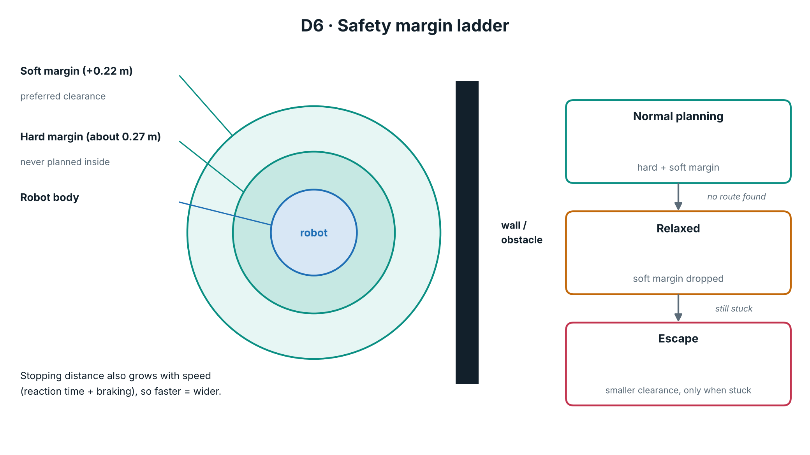
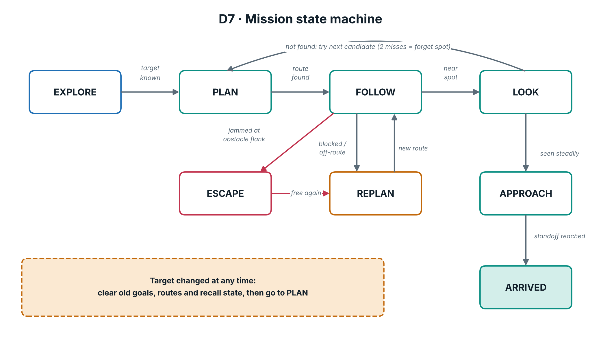
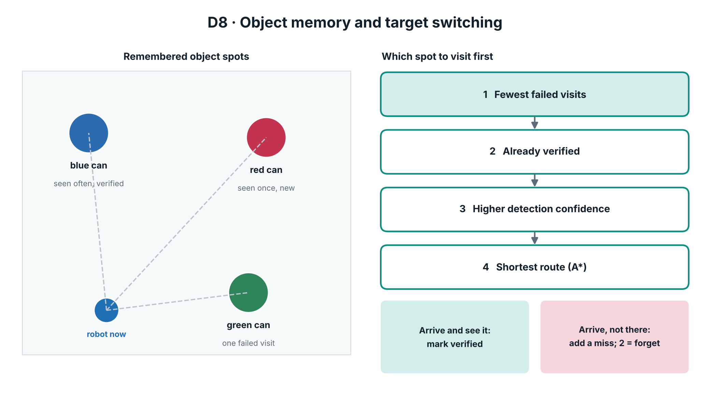

# Algorithms

Plain-language descriptions of what each part does, with the real parameters from `robot_sim.py`.
All of this runs in the simulator; none of it has been tried on a physical robot.

## 1. Occupancy grid (log-odds)

The room is split into 15 cm cells (`MRES = 0.15`). Each cell stores a running score. A range ray that passes through a
cell lowers its score (probably free); the cell where a ray ends raises it (probably occupied). Because scores add up
over many readings, one noisy reading cannot flip a cell. Cells never reached stay unknown, and nothing is assumed
behind an obstacle.



A second, camera-only layer (`vis`) marks hazards that the detector cannot name. The planner treats it as costly or
forbidden, so the robot avoids objects it has never seen in training.

## 2. Exploration (`best_viewpoint`)

Candidate viewpoints are sampled every 3 cells (`NAV_STRIDE`). Each gets a score:

```
score = gain / (EXP_D0 + EXP_DK * d ** EXP_P)      defaults: 25, 45, 1.15
```

`gain` is how much unsearched floor the viewpoint would reveal; `d` is the route length to get there. Dividing by distance
keeps the robot sweeping nearby areas instead of zig-zagging between opposite corners. A viewpoint must reveal at least
`MIN_GAIN = 120` cells in the first tier, then at least `MIN_GAIN_CELLS = 3` in the second. Spots that repeatedly reveal
nothing earn strikes (`note_scan`) and become `dead`. Exploration ends when no reachable viewpoint has enough gain.



## 3. Route planning (`astar`, Theta\*)

Theta\* is A\* that is allowed to link a cell to a far ancestor whenever there is a clear line of sight. That removes the
staircase pattern of grid A\* and gives short, straight paths. The path cost is driving **time**, not distance, and adds:

- a turn penalty (turn rate 0.9, fixed 0.12 s per turn),
- a 25% penalty for unknown cells,
- a penalty for camera-hazard cells.

The raw path is then string-pulled (smoothed) and densified. `astar_grid` (plain grid A\*) is kept for comparison
(`NAV_GRID=1` environment switch).



## 4. Safety margins (`Safety`)

| Quantity | Value | Meaning |
|---|---|---|
| Robot radius | 0.18 m | Half-length 0.15 m, half-width 0.10 m: radius of the circle swept when turning |
| Hard margin | about 0.27 m | Robot radius + sensor noise + position error + grid error. The planner never goes inside |
| Soft margin | hard + 0.22 m | Preferred clearance: costlier but allowed |
| Reaction time | 0.35 s | Used for stopping distance |
| Deceleration | 0.8 m/s² | `stop_dist(v) = v·react + v² / (2·decel)` |
| Safe speed | `v_safe(free)` | Fastest speed that can still stop inside the free distance |

`margins()` returns a ladder: normal, relaxed (soft margin dropped), and `escape=True` (smaller clearance, used only when
the robot is stuck). CLI: `--margin`, `--soft-margin`, `--react`, `--decel`.



## 5. Following the route (`_follow`, `gap_steer`)

- **Pure pursuit** steers toward a point a short distance ahead on the planned route, giving smooth tracking.
- **Local avoidance** (`gap_steer`) acts only when the route is genuinely blocked, then hands control back to the route.
- **Replanning** triggers when blocked, when cross-track error grows, when progress stalls (turning counts as progress),
  or when the target changes.
- A **flank-contact escape** frees the robot if it touches an obstacle edge (`range < 0.09 m`).

## 6. Mission phases and target switching



Phases include EXPLORE, PLAN, FOLLOW, LOOK (look at a remembered spot), APPROACH, ARRIVED, plus replanning and escape.
`Mission.retarget()` is called on **every** target change. It clears stale goals, waypoints, recall state and detour
state, then selects the new target and plans from the current pose. If the map is already known, it starts directly in PLAN.

## 7. Object memory (`pick_recall`, `verify`, `miss`)

Each sighting joins a cluster storing position, weight, count, last-seen time, miss count and a verified flag. To pick which
spot to visit for a requested object:

1. fewest failed visits,
2. already verified,
3. higher detection confidence (bucketed by sighting count),
4. shortest route.



Arriving and seeing the target marks the cluster verified. Arriving and not seeing it adds a miss; two misses forget the
spot. A false-alarm memory (`sus`/`neg`) stops the same wrong spot from being retried.

## 8. Direct approach (`approach_goal`, `_approach_step`)

When the target is detected steadily and is between `standoff + 0.55 m` and `2.6 m` away, the robot plans a route to the
cheapest reachable standing point at the target's standoff distance (0.40 m for cans, 0.90 m for a person) with a clear
view, instead of circling it.

## 9. Delay handling

`AsyncDetector` runs detection on a separate thread. Only the newest frame is queued (no backlog), and each result is
stamped with the pose and time of the frame it came from. The target is stored as a point in the world, and its bearing
and distance are recomputed from the car's current pose every tick, so motion stays smooth when vision is slow. `--bench N --latency S` emulates a detector that
needs `S` seconds per frame.

## 10. Detector training

`--collect N` renders N simulator images and labels them automatically from PyBullet's segmentation mask (no hand
labelling). `--train` fine-tunes YOLOv8n on them. Classes: the three cans, the person, and `obstacle`.
