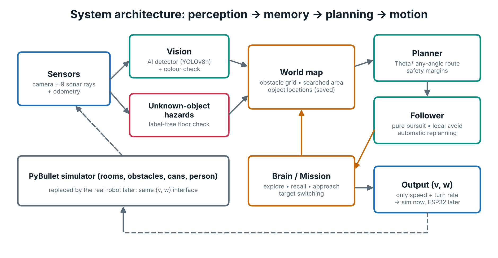
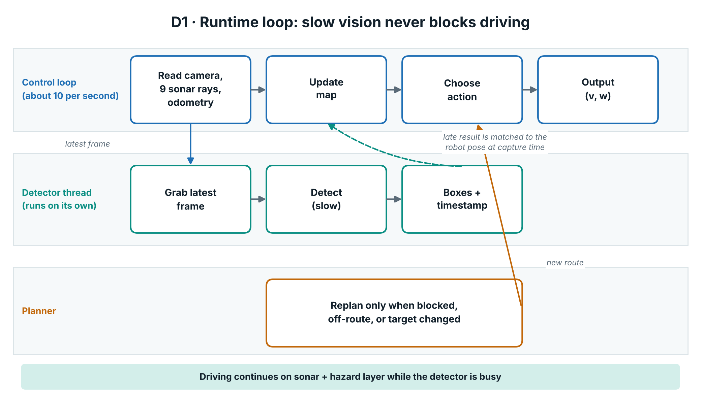
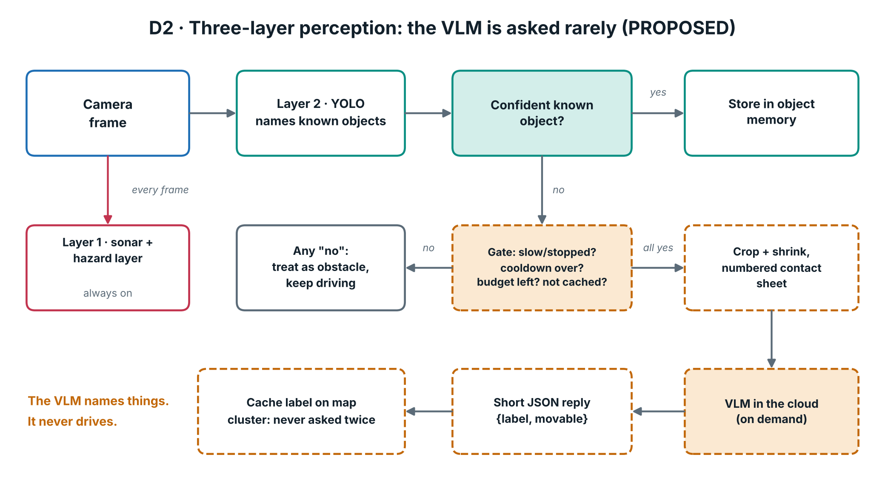

# Architecture

SIGHTWAY is one control loop (about 10 ticks per second, `DT = 0.1 s`) wrapped around a shared world map.
Everything below is **built and tested in the simulator** unless marked *Proposed*.

## Components (all in `robot_sim.py`)

| Component | Class / function | Job |
|---|---|---|
| Simulator | `Sim` | PyBullet room with random obstacles, three cans and a person; renders the camera and casts range rays |
| Detectors | `TrainedDetector`, `ColorDetector`, `GroundTruthDetector`, `HybridDetector`, `YoloWorldDetector` | Turn a camera frame into labelled boxes. `make_detector(name)` picks one |
| Async wrapper | `AsyncDetector` | Runs detection on its own thread so slow vision never stalls the control loop |
| Hazard layer | `floor_hazards`, `hazard_boxes` | Label-free check: anything on the floor that is not floor is a hazard, even if no detector can name it |
| World map | `WorldMap` | 15 cm grid: obstacle log-odds, searched area, hazards, object memory, planners, save/load |
| Brain | `Brain` | Per-tick decisions: follow route, local avoidance, approach, escape |
| Mission | `Mission` | State machine, target switching, temporary map storage, auto-save |
| Safety | `Safety` (`SAFE`) | Every margin and braking number in one place |
| UI | `render_ui`, `draw_map` | Dashboard, key bindings, typed commands |
| Training | `collect_dataset`, `train_detector` | Auto-labelled data from the simulator, YOLOv8n training |

## Data flow per tick

1. **Sense.** Camera frame + 9 range sensors (5 sub-rays each) + odometry.
2. **Perceive.** The async detector returns boxes (possibly from an older frame). The hazard layer runs on the same frame.
3. **Map.** Range hits and misses update the obstacle log-odds grid. Detections update object clusters. Hazards go into a camera-only layer.
4. **Decide.** `Mission` picks a phase (see [ALGORITHMS.md](ALGORITHMS.md)); `Brain` turns it into a goal.
5. **Plan.** `WorldMap.route()` runs Theta\* with the current safety margins.
6. **Follow.** Pure pursuit tracks the route; local avoidance (`gap_steer`) only acts when the path is genuinely blocked.
7. **Output.** Only `(v, w)`: forward speed (max 0.6 m/s) and turn rate (max 1.6 rad/s).

## Why `(v, w)` only

The brain never touches the simulator's internals when it acts. It outputs a speed and a turn rate, which is exactly what
a differential-drive car needs. Replacing the simulator with an ESP32 car means implementing the same interface
(see [HARDWARE_PLAN.md](HARDWARE_PLAN.md)). That step is **proposed, not built**.

## Perception layers

| Layer | Runs | Purpose | Status |
|---|---|---|---|
| 1. Sonar + camera hazard | Every frame | Safety against anything, labelled or not | Built |
| 2. Detector (YOLOv8n / colour) | Every frame, async | Name the target cans and the person | Built |
| 3. VLM | Rarely, on demand | Name unfamiliar objects | **Proposed** (see [VLM_DESIGN.md](VLM_DESIGN.md)) |

## Persistence

The room map, object clusters and bookkeeping are saved to `robot_map.npz` + a JSON side file in the system temp folder
(`--store` changes the path) every 5 seconds, and re-loaded only when the room seed matches. `--reset-map`, key `r`, or
the typed command `reset map` wipes it. `--no-store` disables it.
