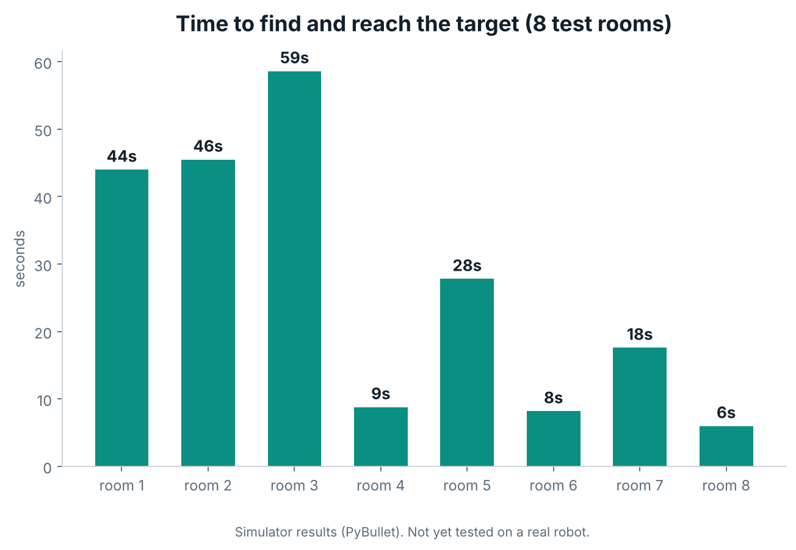
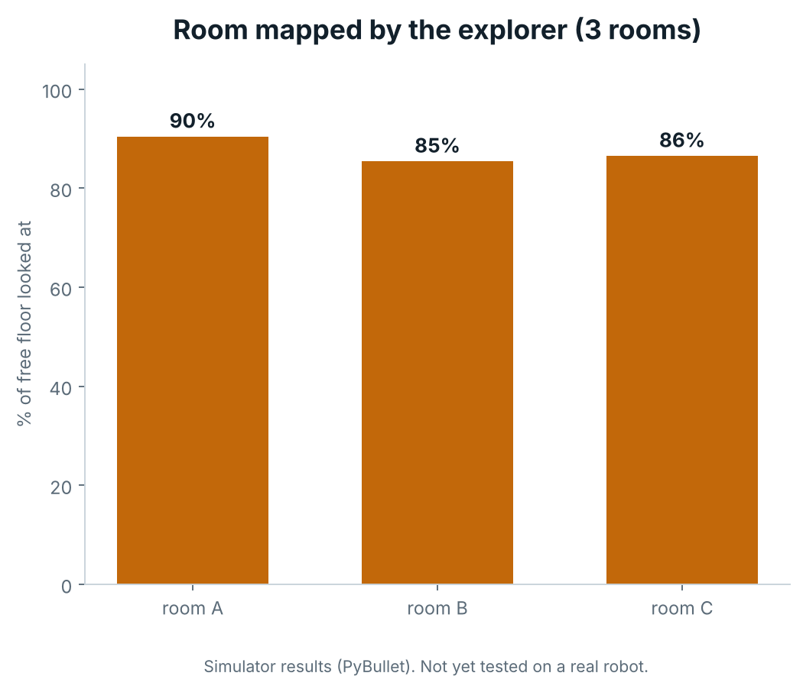

# Testing and results

All results are from the **PyBullet simulator**. None come from a real robot.

## Regression tests

```bash
python test_nav.py          # prints PASS/FAIL per test
pytest -q test_nav.py       # optional
```

Set `ROBOT_SIM=/path/to/other_version.py` to run the same tests against another copy of the simulator file.

| Test | What it checks |
|---|---|
| `test_exploration_terminates_only_when_everything_reachable_was_searched` | Exploration stops only when nothing reachable is left unsearched, including an alcove |
| `test_exploration_never_revisits_the_same_place` | No chosen viewpoint is within 0.85 m of an earlier one |
| `test_route_without_obstacles_is_followed_directly` | An obstacle-free route is followed without detours |
| `test_unexpected_obstacle_causes_one_detour_then_the_route_resumes` | A surprise crate triggers a replan, then the route resumes, with 0 collisions |
| `test_switching_targets_always_goes_to_the_requested_one_by_a_short_route` | 7 legs (blue, red, green, blue, green, red, blue) always head for the requested can |

Last full run: all 5 passed (on the final delivered `robot_sim.py`, Python 3.13).

## Benchmark

```bash
python robot_sim.py --bench 8 --seed 900 --target mix --headless --csv bench.csv
python robot_sim.py --bench 8 --seed 900 --target mix --headless --latency 0.8   # slow-vision test
python robot_sim.py --bench 3 --mode map --headless                              # mapping coverage
python robot_sim.py --bench 8 --novel --headless                                 # unfamiliar obstacles
```

### Measured results (trained detector)

| Metric | Result |
|---|---|
| Targets found, 8 random rooms | 8 / 8 |
| Collisions | 0 |
| Average time to reach target | about 27 s |
| Room coverage, 3 rooms | 85 to 90% of free floor looked at, 0 collisions |
| Target switching, 7 legs in one room | 7 / 7 |




Per-room times: 44, 46, 59, 9, 28, 8, 18, 6 s.

### Earlier-build results (not re-run on the final file)

- With an artificial 0.8 s detector delay, 8 / 8 rooms were still solved.
- In one room, finding a can took about 20 s with a saved map and about 100 s without.

## Known issues

- The colour-only detector fails to find the target in one benchmark room (room 902).
- The object memory can keep a few false locations next to real ones.
- Loaded-map slowness (seed 903) and a novel-object mid-route timeout (seed 905) were seen earlier and not re-tested.
- Average find time is about 5 s slower than an older build (27 s vs about 22 s); the cause was not isolated.
- Everything is simulator-only.

## Reproducing

Results vary with seeds, hardware speed and the detector weights. Use the same seeds (`--seed 900`) for a like-for-like run.
