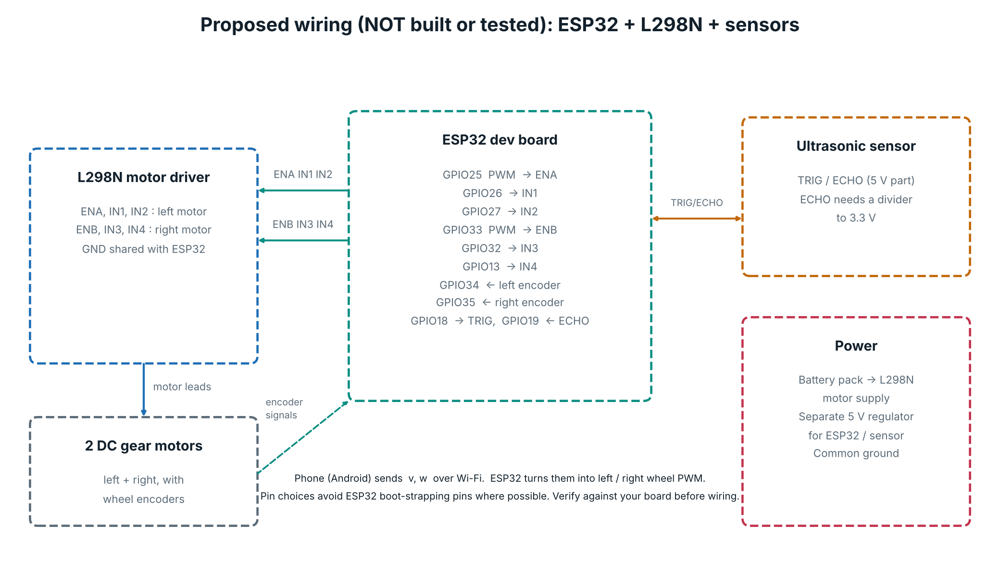

# Hardware plan and simulation

> **Status:** no physical hardware has been built or tested. The functional prototype is the **PyBullet simulation**
> in this repository. This page documents the proposed hardware, how the simulation stands in for it, and the plan to build it.
> All wiring and component choices below are **proposed**; values marked "typical" must be checked against the real parts.

## 1. What the simulation demonstrates

The simulator replaces the car, camera and range sensors. The brain (mapping, planning, safety, target switching) is the
same code that would run on the phone. It outputs only forward speed `v` and turn rate `w`, which is exactly what a
differential-drive car needs.

| Real part (proposed) | Simulated by | Where |
|---|---|---|
| RC car with 2 driven wheels | PyBullet car, `V_MAX = 0.6 m/s`, `W_MAX = 1.6 rad/s` | `Sim` in `robot_sim.py` |
| Phone camera | PyBullet camera, 70° horizontal FOV | `Sim` |
| Ultrasonic / range sensors | 9 sonar rays, up to 3.5 m, with noise | `Sim`, `RMAX` |
| Wheel encoders | Odometry pose | `Sim` |
| Phone processing | The Python brain, async detector thread | `Mission`, `Brain`, `AsyncDetector` |

### Run the simulation

```bash
pip install -r requirements.txt
python robot_sim.py --target "blue energy drink can" --seed 5     # live dashboard
python robot_sim.py --bench 8 --seed 900 --target mix --headless   # benchmark
python test_nav.py                                                  # regression tests
```

More options are in the README and in [TESTING.md](TESTING.md).

## 2. Proposed hardware components

| Component | Role | Typical specification (verify on the real part) |
|---|---|---|
| Android phone | Camera, runs detector, map and planner, sends `v, w` | Any recent Android phone with a camera and Wi-Fi |
| ESP32 development board | Receives `v, w`, drives motors, reads encoders | 3.3 V logic, built-in Wi-Fi and Bluetooth |
| L298N dual H-bridge driver | Drives two DC motors | Motor supply about 5 to 35 V, about 2 A per channel; has voltage drop, so check battery headroom |
| 2 DC gear motors with encoders | Drive wheels and report wheel motion | Voltage and encoder resolution depend on the chosen chassis |
| Ultrasonic sensor (for example HC-SR04) | Close-range obstacle distance | 5 V part, about 2 cm to 4 m; ECHO output must be level-shifted to 3.3 V |
| Battery pack and 5 V regulator | Motor power and logic power | Sized from the motors' stall current |
| RC car or 2-wheel chassis | Frame, wheels | Measure wheel diameter and wheel separation `L` |

## 3. Circuit connections (proposed, untested)



| ESP32 pin | Connects to | Purpose |
|---|---|---|
| GPIO25 (PWM) | L298N ENA | Left motor speed |
| GPIO26 | L298N IN1 | Left motor direction |
| GPIO27 | L298N IN2 | Left motor direction |
| GPIO33 (PWM) | L298N ENB | Right motor speed |
| GPIO32 | L298N IN3 | Right motor direction |
| GPIO13 | L298N IN4 | Right motor direction |
| GPIO34 | Left encoder | Input-only pin |
| GPIO35 | Right encoder | Input-only pin |
| GPIO18 | Ultrasonic TRIG | Trigger |
| GPIO19 | Ultrasonic ECHO | Through a voltage divider to 3.3 V |
| GND | L298N GND, sensor GND, battery negative | Common ground (required) |

Power: battery to the L298N motor supply; a separate regulated 5 V to the ESP32 and sensor.

## 4. System architecture with hardware

```
Android phone (camera, brain)  --Wi-Fi: "v,w"-->  ESP32  -->  L298N  -->  left / right motors
        ^                                            |
        |------- encoder + ultrasonic data ----------+
```

The software architecture is in [ARCHITECTURE.md](ARCHITECTURE.md). Only the output stage changes: the simulator's
car is replaced by this link.

## 5. Control interface

For a differential-drive car with wheel separation `L`:

```
v_left  = v - w * L / 2
v_right = v + w * L / 2
```

The ESP32 converts wheel speeds to PWM with a calibration measured on the real car. Message format (draft): the text
`"v,w\n"` such as `"0.30,-0.40\n"`, sent over UDP or BLE. The ESP32 **stops the motors if no packet arrives within a
timeout** (for example 300 ms). That safety timeout is mandatory.

## 6. Proposed physical implementation steps

1. Measure real top speed, turn rate and braking distance; update `Safety` (`react`, `decel`, `half_len`, `half_wid`).
2. Build the ESP32 receiver with the stop-on-timeout rule; test with the wheels off the ground.
3. Replace simulated pose with encoder odometry; check drift over a lap.
4. Replace the 9 simulated range rays with real sensors (or camera depth) and re-tune the noise values.
5. Photograph the real cans and obstacles, retrain the detector (see README), test in a cleared room.
6. Only then run the full explore / go-to-object loop, at reduced speed first.

## 7. Simulation limitations

- The detector is trained only on simulator images; real cameras need real photos.
- Margins and speeds are tuned for the simulator.
- Simulated odometry is much cleaner than real wheel odometry; there is no wheel slip, IMU fusion or motor dynamics model.
- Simulated sonar has simple noise only; real ultrasonic sensors have wide beams, echoes and dead zones.
- No firmware or hardware code exists in this repository yet.
- Results (see [TESTING.md](TESTING.md)) are simulator results, not hardware results.
